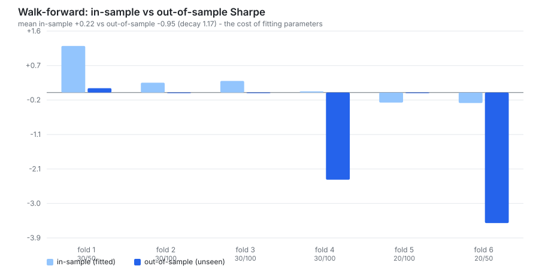
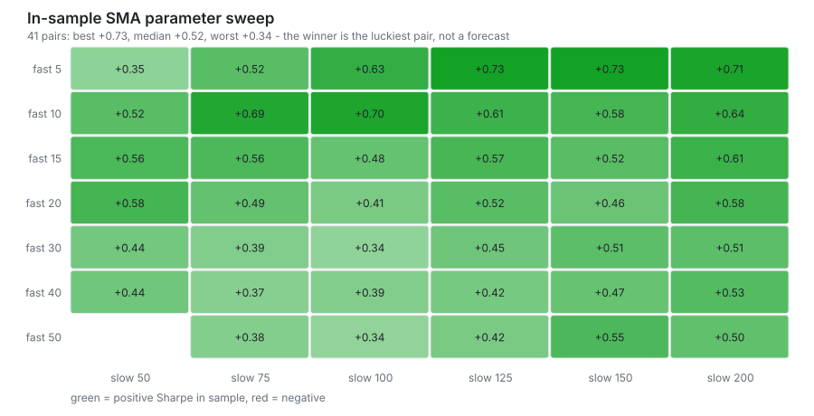
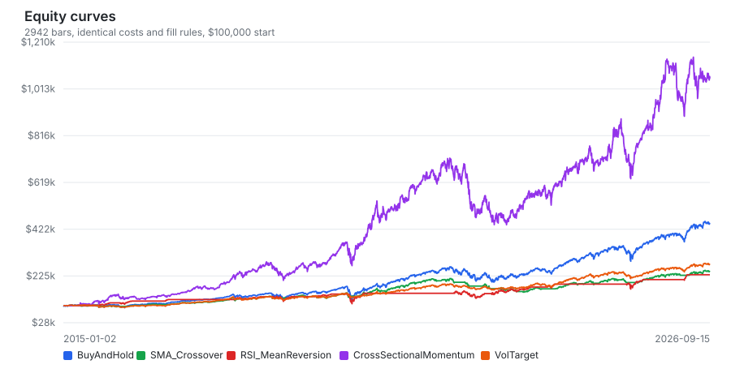
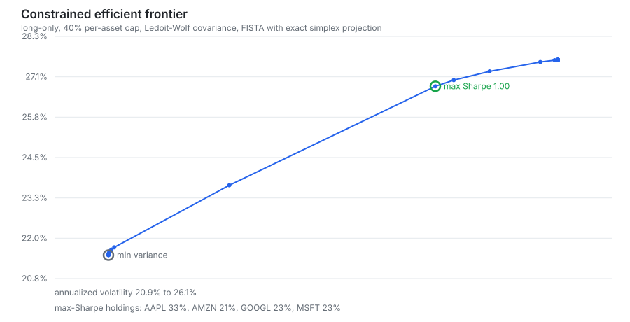
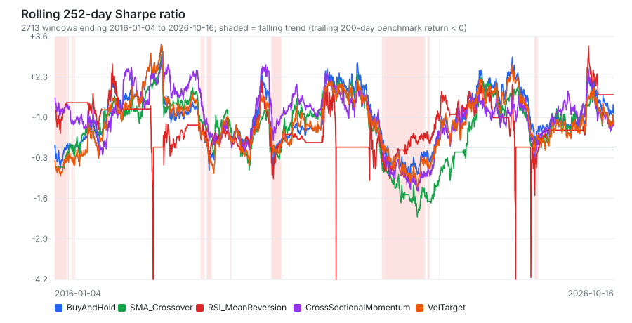
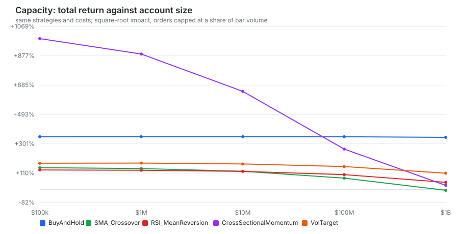
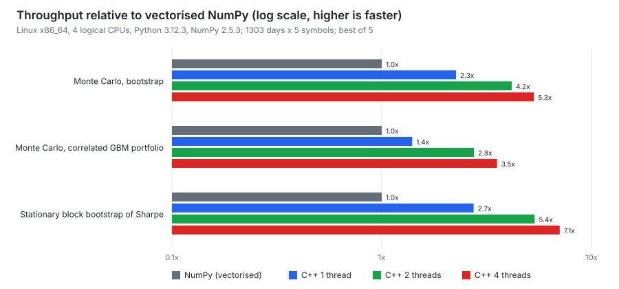

# AxiomQuant

[](https://github.com/Lukey-7/AxiomQuant/actions/workflows/ci.yml)
[](https://en.cppreference.com/w/cpp/20)
[](LICENSE)

A quantitative research engine I built in modern C++20: event-driven backtesting with realistic
transaction costs, risk and tail analytics, parallel Monte Carlo, Markowitz portfolio optimization,
and **walk-forward out-of-sample evaluation**. Every solver — the constrained QP, the Ledoit-Wolf
estimator, the VaR models, the random number generator — is implemented from first principles, with
Eigen used only for linear algebra and SQLite for persistence.

The point of the project is not to show a profitable strategy; it is to build machinery honest enough
to tell you when a strategy is *not* profitable. On 11.7 years of real prices it says exactly that:
walk-forward SMA crossover returned +32.3% out of sample against +254.6% for buy-and-hold SPY, and
that +32.3% is not statistically distinguishable from zero.

### What I built, in one table

| Area | What it does | Where |
|---|---|---|
| Backtesting | Event loop, next-bar-open fills, four-component cost model, five strategies | `backtest/` |
| Risk | CAGR, Sharpe, Sortino, Calmar, drawdowns, VaR/CVaR three ways | `risk/` |
| Optimization | Covariance + Ledoit-Wolf, GMV/tangency, constrained QP, frontier, risk parity | `optimization/` |
| Simulation | Reproducible per-path RNG, i.i.d. and block bootstrap, correlated GBM | `simulation/` |
| Honesty layer | Walk-forward, cost sweeps, capacity sweep, block-bootstrap error bars, deflated Sharpe, Reality Check / SPA, regime split | `analysis/` |
| Point-in-time data | Index membership calendar so strategies cannot hold tomorrow's winners | `data/` |
| Verification | 89 tests on 4 platforms, golden-output regression test, CSV loader fuzzing, cvxpy cross-check, NumPy benchmark, coverage floor | `.github/`, `tests/` |

### What it found

- Simple technical strategies **did not** beat buy-and-hold after costs, out of sample.
- That result has an error bar: Sharpe 0.19, 95% interval −0.42 to 0.82, p = 0.28.
- In-sample parameter selection overstated performance by about **2.7×**.
- Survivorship bias was worth roughly **850 percentage points**: momentum returned +957.7% on five
  symbols chosen today and +106.6% on the S&P 500 as it actually was.
- The one useful positive result: **volatility targeting** matched buy-and-hold's Sharpe (0.69 vs
  0.71) with a **13.2%** maximum drawdown instead of 33.4%.
- Cross-checking the optimizer against cvxpy found a real bug in the risk-parity solver.
- Testing all four strategies against buy-and-hold at once (White's Reality Check and Hansen's SPA
  test), the best one, momentum, **passes** (p = 0.020 and 0.017). That is the survivorship bias above
  showing through, not an edge: the test charges for trying several strategies, not for choosing the
  five symbols after the fact.
- Splitting by market regime shows why the trend rule lags: SMA crossover's Sharpe is 0.78 in rising
  markets and −0.05 in falling ones, while RSI mean reversion is the mirror image (0.09 rising, 1.23
  falling).

The SPA and regime figures come from [Real data run 38026970839](https://github.com/Lukey-7/AxiomQuant/actions/runs/38026970839)
(same five symbols, 2015-01-02 to 2026-10-09); the rest from run 35057670453, quoted below.

Full write-ups: **[RESEARCH.md](RESEARCH.md)** ·
**[survivorship study](docs/guide/reports/SP500_STUDY.md)** ·
**[Quant From Zero — a guide for beginners](docs/guide/quant-from-zero/QUANT_FROM_ZERO.md)**
([PDF](docs/guide/quant-from-zero/Quant-From-Zero.pdf))

89 unit and regression tests, a golden-output check of the full CLI run and a CSV fuzz replay run on
Linux (GCC), macOS (Apple Clang), Windows (MSVC) and under AddressSanitizer +
UndefinedBehaviorSanitizer on every push, and the CSV loader is fuzzed with libFuzzer for three minutes. Two further jobs check the engine against
outside references: every optimizer against cvxpy/Clarabel and closed-form solutions to 1e-8, and the
Monte Carlo and bootstrap workloads against vectorised NumPy implementations of the same tasks.
Formatting, static analysis and an 80% line-coverage floor are enforced on every push as well.

---

## Results at a glance

Every chart below is drawn by `scripts/make_charts.py` from the CLI's own CSV exports, on real daily
prices for SPY, AAPL, AMZN, GOOGL and MSFT. The run behind each one is named under it.

### 1. In sample vs out of sample

Parameters chosen on a training window, then traded unchanged on the next unseen window. The blue
bars are what the optimizer believed; the darker bars are what happened next.



Every pair in an in-sample parameter sweep. The best cell is the one the optimizer would have picked
— and it only just matches buy-and-hold (Sharpe 0.74 vs 0.71), while 38 of 41 pairs fall short.



*Both from [Real data run 35057670453](https://github.com/Lukey-7/AxiomQuant/actions/runs/35057670453)
(2015-01-02 to 2026-09-14).*

### 2. Equity curves and the efficient frontier

All five strategies with identical costs, capital and fill rules, and the long-only frontier with a
40% cap per asset.





*Both from [Real data run 35057670453](https://github.com/Lukey-7/AxiomQuant/actions/runs/35057670453).*

### 3. When does a strategy work? Rolling Sharpe by regime

A rolling one-year Sharpe ratio for each strategy, with falling-trend periods (trailing 200-day
benchmark return below zero) shaded. One number for 11.7 years hides that the trend rule and the
mean-reversion rule take turns.



### 4. How big can the account get? Capacity

The same strategies at account sizes from $100k to $1B, with square-root market impact and each
order capped at 10% of a day's volume. Momentum's return halves by $25M; the SMA crossover breaks
even just under $1B; buy-and-hold barely moves. The table is in RESEARCH.md section 2.



*Sections 3 and 4 from [Real data run 39221101387](https://github.com/Lukey-7/AxiomQuant/actions/runs/39221101387)
(2015-01-02 to 2026-10-16).*

### 5. Speed against NumPy

Throughput of the Monte Carlo and bootstrap workloads relative to vectorised NumPy implementations of
the same tasks; the table is under [Performance](#performance).



To redraw the charts from any run:

```bash
./build/bin/axiomquant --data sample_data --no-db --export-dir out
python3 scripts/make_charts.py --input out --output docs/images
```

---

## How the project grew

In the order it was built, from the commit history.

| Stage | What was added | Why it mattered |
|---|---|---|
| 1. Core engine | Event-driven backtester with next-bar-open fills, realized-PnL trade statistics, deterministic Monte Carlo, correlated GBM, Ledoit-Wolf covariance, exact simplex projection | Removed the look-ahead fills and order-sizing bugs that make most toy backtests lie |
| 2. Walk-forward | Rolling train/test evaluation and parallel parameter sweeps | Turned "best in-sample Sharpe" into an out-of-sample test |
| 3. Real data | Live Yahoo/Tiingo, Kaggle and CSV import, synthetic generator; a *Real data* workflow | Every published number comes from a named CI run on real prices |
| 4. Significance | Block-bootstrap Sharpe intervals, probabilistic and deflated Sharpe, Politis-White block length, effective trial count | Gave the headline result an error bar, which shows it is indistinguishable from zero |
| 5. Outside references | Optimizer cross-checked against cvxpy/Clarabel, Monte Carlo and bootstrap benchmarked against NumPy | Found and fixed a real risk-parity bug |
| 6. Engineering hygiene | clang-format, clang-tidy, 80% coverage floor, ASan + UBSan build | Static and dynamic checks on every push |
| 7. Costs and sizing | Cost-sensitivity sweep, volatility-targeted sizing | Volatility targeting: buy-and-hold's Sharpe with 13.2% drawdown instead of 33.4% |
| 8. Point-in-time universe | Index membership calendar and an S&P 500 study | Measured survivorship bias: momentum +957.7% on five names, +106.6% on the real index |
| 9. Fairer protocol | Walk-forward that can carry the position into each window, swept over window sizes | Showed the conclusion does not depend on one test setup |
| 10. Multiple testing | White's Reality Check and Hansen's SPA test | Charges for trying several strategies at once |
| 11. Regimes | Point-in-time trend/volatility labels, per-regime metrics, rolling Sharpe | Explained *when* each rule works |
| 12. Python bindings | pybind11 module `axiomquant`, cross-checked against the CLI | Usable from a notebook |
| 13. Faster Monte Carlo | Correlated GBM in blocks of 8 paths, bit-identical to the reference | Removed the one slow stage of the pipeline |
| 14. CSV fuzzing | libFuzzer target under ASan/UBSan plus a replay driver in every build | Found duplicate dates, infinite prices, negative volume, impossible dates and "1,000.5" read as 1.0, all fixed |
| 15. Execution realism | Optional volume-participation cap with carried remainders, short borrow fee | Orders no longer assume infinite liquidity when the cap is on |
| 16. Capacity | Same strategies from $100k to $1B, with half-return and break-even sizes | Answers "at what size does this stop working?" |
| 17. Golden output | The CLI's full output pinned in `tests/golden`, compared to the last printed digit | Any unintended change to a number fails CI |

---

## Architecture

```
                 sample_data/*.csv                      SQLite (quant_data)
                        |                                  ^        |
                        v                                  |        v
            +-----------------------+   persists runs,  +-----------------------+
            |  quant_data           |   trades, curves  |  market_data          |
            |  CsvLoader            |------------------>|  backtest_runs        |
            |  TimeSeries (columnar)|                   |  trades, equity_curve |
            |  MarketDataUniverse   |                   +-----------------------+
            +-----------+-----------+
                        | synchronized timeline, aligned closes, slice()
        +---------------+----------------+--------------------------+
        v                                v                          v
+---------------------+   +-----------------------------+   +------------------------+
| quant_indicators    |   | quant_backtest              |   | quant_optimization     |
| SMA EMA RSI MACD    |-->| BacktestEngine (event loop) |   | sample & Ledoit-Wolf   |
| Bollinger ATR vol   |   | ExecutionModel (costs)      |   | GMV / tangency (exact) |
+---------------------+   | Portfolio, Position         |   | constrained QP (FISTA) |
                          | strategies: SMA, RSI,       |   | risk parity, frontier  |
                          |   momentum, buy & hold      |   +-----------+------------+
                          +--------------+--------------+               |
                                         |                              |
                 +-----------------------+------------+                 |
                 v                                    v                 v
      +---------------------+            +-------------------------------------+
      | quant_risk          |            | quant_analysis                      |
      | Sharpe Sortino      |            | evaluate_window (warm-up, no trade) |
      | Calmar drawdown     |            | sweep_sma_parameters (OpenMP)       |
      | VaR/CVaR: historical|            | run_sma_walk_forward (rolling OOS)  |
      | Gaussian, Cornish-  |            +-------------------+-----------------+
      | Fisher; reports     |                                |
      +----------+----------+                                |
                 |                                           |
                 v                                           v
      +-------------------------------+          +--------------------------+
      | quant_simulation              |          | cli: axiomquant          |
      | bootstrap + correlated GBM    |--------->| 9-stage pipeline, CSV    |
      | deterministic per-path RNG    |          | export, SQLite, reports  |
      +-------------------------------+          +--------------------------+
```

---

## Modules

### `quant::data`
Columnar `TimeSeries` (separate OHLCV vectors for vectorization-friendly access), a CSV loader that
accepts arbitrary column order and skips malformed rows (non-finite or non-positive prices, negative
volume, impossible dates, duplicate dates, numbers with trailing text; it is fuzzed in CI with
libFuzzer under ASan and UBSan), and `MarketDataUniverse`, which synchronizes
multiple assets onto one timeline (intersection, or union with forward-fill). It exposes
`get_aligned_closes()` for indicator computation and `slice()` for walk-forward windows.
`SqliteStorage` persists price history, run summaries, fills and equity curves.

### `quant::indicators`
SMA (O(1) rolling accumulator), EMA (α = 2/(N+1), SMA-seeded), RSI (Wilder smoothing), MACD,
Bollinger Bands with %B and bandwidth, annualized rolling volatility of log returns
(σ_ann = √252 · std(ln(P_t/P_{t-1}))), and ATR over Wilder's true range
(max(H−L, |H−C_prev|, |L−C_prev|)). Warm-up values are NaN, never silently zero.

### `quant::backtest`
Event-driven loop over the synchronized timeline. Orders emitted on bar *t* execute at bar *t+1*'s
open (`FillTiming::NextBarOpen`, the default); `SameBarClose` exists only for comparison studies.
The execution model charges per-share and percentage commissions with a minimum ticket, a half
bid-ask spread, fixed slippage, and square-root market impact ΔP/P = η·√(Q/V). Two optional
frictions are off by default: a participation cap (`--max-participation`) that lets an order take at
most a share of the bar's volume and carries the rest to the next bar, where a newer order for the
ticker replaces it, and a borrow fee on short positions (`--borrow-rate`). Positions track
average cost, realized and unrealized PnL; every fill records the PnL it realized and whether it
closed a position. Strategies: SMA crossover, RSI mean reversion, cross-sectional momentum (with an
optional absolute-momentum filter and point-in-time index membership), volatility targeting (position
sized at target vol / trailing vol), and buy-and-hold.

### `quant::risk`
CAGR from the calendar span, annualized volatility, Sharpe, Sortino (downside semi-deviation below
MAR), Calmar, drawdown depth/duration/recovery, skewness and excess kurtosis. VaR and CVaR three
ways — historical (empirical quantile), Gaussian parametric, and Cornish-Fisher, which corrects the
normal quantile for skew and fat tails:

```
z_cf = z + (S/6)(z² − 1) + (K/24)(z³ − 3z) − (S²/36)(2z³ − 5z)
```

Trade statistics (win rate, profit factor, average trade) are computed from realized PnL on closing
fills.

### `quant::simulation`
Monte Carlo with one xoshiro256\*\* stream per path, seeded from (seed, path index) by SplitMix64, and
a Marsaglia polar normal sampler. Output is bit-identical at any thread count and on any standard
library. Two engines: i.i.d. bootstrap resampling of a historical return series, and a correlated
multi-asset GBM that draws x_t = drift + L·z_t with L·Lᵀ = Σ_daily (Cholesky) and values a
buy-and-hold or daily-rebalanced portfolio. Paths are streamed — no allocation per path.

### `quant::optimization`
Sample covariance and **Ledoit-Wolf shrinkage to the constant-correlation target** (Ledoit & Wolf,
2004), including the ρ term of the optimal intensity:

```
Σ_LW = δF + (1−δ)S,   F_ii = s_ii,  F_ij = r̄·√(s_ii·s_jj),   δ = clamp((π̂ − ρ̂)/(T·γ̂), 0, 1)
```

Closed-form GMV `w = Σ⁻¹1 / 1ᵀΣ⁻¹1` and tangency `w ∝ Σ⁻¹(μ − r_f·1)`, a constrained QP solved by
Nesterov-accelerated projected gradient (FISTA) onto the bounded simplex
`{w : Σw = 1, w_min ≤ w_i ≤ w_max}` via an **exact O(N log N) breakpoint sweep**, constrained
max-Sharpe by grid scan plus golden-section refinement, risk parity by cyclical coordinate descent,
and an efficient frontier with ASCII rendering.

### `quant::analysis`
`evaluate_window` backtests one timeline window, replaying warm-up bars with trading disabled so each
window starts flat. `sweep_sma_parameters` evaluates every (fast < slow) pair in parallel.
`run_sma_walk_forward` rolls train/test windows forward, selecting parameters in sample and trading
them unchanged on unseen data, against a buy-and-hold benchmark over the same days. `sweep_costs`
re-runs every strategy with all costs scaled together, and `sweep_capacity` re-runs it at account
sizes from $100k to $1B with a participation cap, reporting the size at which the return halves and
the size at which it reaches zero.

---

## Build

Requirements: a C++20 compiler (GCC 11+, Clang 14+, MSVC 2022), CMake 3.20+. OpenMP is optional —
without it the simulation kernels run serially and produce identical numbers. Eigen 3.4 and the
SQLite 3.46 amalgamation are vendored, so there is nothing to install.

```bash
git clone https://github.com/Lukey-7/AxiomQuant.git
cd AxiomQuant
cmake -B build -DCMAKE_BUILD_TYPE=Release
cmake --build build --parallel
ctest --test-dir build --output-on-failure
```

**Windows (MSVC / Build Tools 2022):**

```bat
cmake -B build
cmake --build build --config Release --parallel
ctest --test-dir build -C Release --output-on-failure
```

**macOS:** Apple Clang has no OpenMP; the build detects this and falls back to serial kernels. For
parallelism, `brew install libomp` and configure with `-DOpenMP_ROOT=$(brew --prefix libomp)`.

Options: `-DAXIOM_BUILD_TESTS=OFF`, `-DAXIOM_BUILD_CLI=OFF`, `-DAXIOM_ENABLE_OPENMP=OFF`,
`-DAXIOM_NATIVE=ON` (tune for the host CPU), `-DAXIOM_BUILD_FUZZERS=ON` (Clang: the libFuzzer target
`fuzz_csv_loader`).

`ctest` also runs a **golden-output test**: the CLI's full output on `sample_data`, pinned in
`tests/golden/expected`, must match to one unit in the last printed digit. After a change that is
meant to move the numbers, regenerate the copies with `cmake --build build --target update_golden`
and review the diff.

---

## Running

```bash
./build/bin/axiomquant --data sample_data
```

```
--data <dir>          directory of <TICKER>.csv OHLCV files      (default: sample_data)
--ticker <symbol>     asset for single-name strategies           (default: SPY)
--capital <usd>       starting capital                           (default: 100000)
--rf <rate>           annual risk-free rate used in Sharpe       (default: 0.02)
--fill <open|close>   next-bar-open (default) or signal-close fills
--max-weight <w>      per-asset cap for the constrained optimizer (default: 0.40)
--max-participation <f>  largest share of a bar's volume one order takes (default: 0 = no cap)
--borrow-rate <rate>  annual fee on short positions             (default: 0)
--paths <n>           Monte Carlo paths                          (default: 50000)
--horizon <days>      Monte Carlo horizon in trading days        (default: 252)
--seed <n>            Monte Carlo and bootstrap seed             (default: 42)
--bootstrap <n>       bootstrap resamples, significance test     (default: 10000)
--block <days>        Monte Carlo bootstrap mean block length    (default: 1 = i.i.d.)
--members <csv>       point-in-time index membership            (default: none)
--wf-train <bars>     walk-forward training window               (default: 504)
--wf-test <bars>      walk-forward test window                   (default: 126)
--db <path> | --no-db SQLite persistence                         (default: axiomquant.db)
--export-dir <dir>    write equity curves, trades, weights, sweeps and folds as CSV
-h, --help
```

Examples:

```bash
# quick pass, no database, CSV exports for further analysis
./build/bin/axiomquant --data sample_data --no-db --paths 10000 --export-dir out

# a different benchmark, tighter concentration cap, one-year walk-forward windows
./build/bin/axiomquant --ticker AAPL --max-weight 0.25 --wf-train 756 --wf-test 252

# reproduce the look-ahead-biased convention to see how much it flatters results
./build/bin/axiomquant --fill close

# a $50M account that may take at most 5% of any day's volume
./build/bin/axiomquant --capital 50000000 --max-participation 0.05
```

---

## Python

An optional pybind11 module, `axiomquant`, exposes the engine to notebooks and scripts: load a CSV
directory, run the built-in strategies with the same cost model and fill rules as the CLI, and get
equity curves as NumPy arrays alongside the risk metrics, walk-forward and significance tests.

```bash
python -m pip install pybind11 numpy
cmake -S . -B build -DCMAKE_BUILD_TYPE=Release -DAXIOM_BUILD_PYTHON=ON
cmake --build build --parallel
PYTHONPATH=build/python python python/examples/quickstart.py
```

```python
import axiomquant as aq
universe = aq.load_universe("sample_data")
result = aq.backtest(universe, aq.sma_crossover("SPY", fast=20, slow=50))
result.equity, result.metrics.sharpe_ratio
```

See [python/README.md](python/README.md) for Linux, macOS and Windows instructions and the full API.

---

## Using other data: live, Kaggle, synthetic

The bundled `sample_data/` is synthetic (see [RESEARCH.md](RESEARCH.md) for the evidence). The CLI
reads any directory of `<TICKER>.csv` files, and `scripts/fetch_data.py` (standard library only)
builds one from three kinds of source:

```bash
# Live prices. Yahoo Finance by default, no key; set TIINGO_API_KEY to fall back to Tiingo.
python3 scripts/fetch_data.py live --out real_data --tickers SPY AAPL MSFT GOOGL AMZN --start 2015-01-01

# CSVs you already have: a Kaggle download, a broker export, a spreadsheet. Works with one file per
# symbol or a single long file with a symbol column; headers, date formats and "$" prices are detected.
python3 scripts/fetch_data.py import ~/Downloads/all_stocks_5yr.csv --out kaggle_data --tickers AAPL MSFT AMZN

# Or let it download the Kaggle dataset (pip install kaggle; KAGGLE_API_TOKEN).
python3 scripts/fetch_data.py kaggle camnugent/sandp500 --out kaggle_data --tickers AAPL MSFT AMZN

# Index membership as it was on each date, so cross-sectional strategies cannot rank symbols that
# were not in the index yet. Accepts dated snapshots of the member list or an added/removed log.
python3 scripts/make_membership.py sp500_history.csv --out members.csv
./build/bin/axiomquant --data kaggle_data --members members.csv

# A seeded, correlated GBM universe, when you want data with known properties.
python3 scripts/fetch_data.py synthetic --out synth_data --tickers AAA BBB CCC --seed 7 --correlation 0.3

./build/bin/axiomquant --data real_data --export-dir out
```

Every source is validated the same way (bad or non-positive prices dropped, duplicate dates removed,
rows sorted), adjusted closes are applied to the whole bar, and the script exits non-zero if a symbol
has fewer than `--min-rows` rows. The [Real data workflow](../../actions/workflows/real-data.yml) runs
the live source weekly and can be started by hand with any source, so fetching is verified against the
real feed rather than assumed to work. CI checks the importer offline and runs the CLI on generated
and imported data.

---

## Sample output

All output below is copied from CI run
[34671037291](https://github.com/Lukey-7/AxiomQuant/actions/runs/34671037291), job *Linux (GCC)*, on
the bundled synthetic dataset.

**Strategy tournament** — same costs, same capital, same fill rules:

```
Strategy                                     Return    CAGR     Vol  Sharpe  Sortino    MaxDD   Fills  WinRate    Costs$
-----------------------------------------------------------------------------------------------------------------------
BuyAndHold(SPY)                               18.3%    3.4%   18.3%    0.16     0.39    46.8%       1      n/a        67
SMA_Crossover(SPY, 20/50)                     26.4%    4.8%   12.2%    0.27     0.66    26.0%      27    38.5%      2177
RSI_MeanReversion(SPY, 14)                    -4.5%   -0.9%   11.1%   -0.20    -0.03    26.8%      10    60.0%       606
CrossSectionalMomentum(L=60, R=20, Top=2)     13.0%    2.5%   20.7%    0.12     0.31    52.0%     165    61.4%      4577
```

**Walk-forward, the number that actually matters:**

```
Fold  Test window               Params   IS Sharpe OOS Sharpe  OOS Ret  B&H Ret
   1  2021-12-08..2022-06-01  30/50       1.249      0.118    1.34%    2.70%
   2  2022-06-02..2022-11-24  30/100      0.264      0.000    0.00%  -10.77%
   3  2022-11-25..2023-05-19  30/100      0.311      0.000    0.00%  -12.68%
   4  2023-05-22..2023-11-13  30/100      0.031     -2.339  -12.03%   -0.94%
   5  2023-11-14..2024-05-07  20/100     -0.270      0.000    0.00%   -2.96%
   6  2024-05-08..2024-10-30  20/50      -0.280     -3.502  -12.64%  -12.31%
-------------------------------------------------------------------------
Stitched out-of-sample (750 trading days):
  SMA (walk-forward):  return  -22.11 %   Sharpe -1.396   MaxDD  26.19 %
  Buy & hold:          return  -32.55 %   Sharpe -0.753   MaxDD  39.36 %
  Mean Sharpe: in-sample 0.217  ->  out-of-sample -0.954  (decay 1.171)
```

**Portfolio optimization** (Ledoit-Wolf δ = 1.0000 on this data — see RESEARCH.md for why):

```
Asset              GMV (Uncon)  Tangency (Uncon)   GMV (Long-Only) Max Sharpe (Long)       Risk Parity
AAPL                     8.90%           249.99%            18.09%            40.00%            26.35%
AMZN                    -4.59%           -90.40%             0.78%             0.00%            18.51%
GOOGL                    6.66%            70.45%            15.24%            40.00%            17.87%
MSFT                    15.04%           -95.09%            25.89%             0.00%            16.87%
SPY                     74.00%           -34.95%            40.00%            20.00%            20.40%
Exp Return               6.40%            43.74%             7.76%            12.30%             8.75%
Volatility              17.72%            54.59%            18.56%            20.96%            20.12%
Sharpe (2%)              0.248             0.765             0.310             0.491             0.336
```

---

## Performance

Timings on their own say nothing, so every workload here is also implemented in vectorised NumPy
(`scripts/benchmark.py`, run in CI) and the two are timed on the same machine, on the same inputs,
computing the same statistics. Both implementations print their result so the comparison can be
checked, not assumed.

From CI run [38026764215](https://github.com/Lukey-7/AxiomQuant/actions/runs/38026764215), job
*Benchmark vs NumPy*, `ubuntu-latest` (4 vCPU), GCC 13.3 Release with OpenMP, NumPy 2.5.3,
1303 days × 5 symbols, best of 5 runs:

| Workload | Size | NumPy | C++ 1 thread | C++ 2 threads | C++ 4 threads |
|---|---|---|---|---|---|
| Monte Carlo, bootstrap | 50,000 paths × 252 days | 216 ms | 96 ms (**2.3×**) | 52 ms (4.2×) | 41 ms (5.3×) |
| Monte Carlo, correlated GBM portfolio | 50,000 paths × 252 days | 1,747 ms | 1,250 ms (**1.4×**) | 635 ms (2.8×) | 492 ms (3.5×) |
| Stationary block bootstrap of Sharpe | 10,000 resamples | 278 ms | 101 ms (**2.7×**) | 52 ms (5.4×) | 39 ms (7.1×) |

Single-threaded, the engine is 1.4–2.7× faster than NumPy; the gap is smallest on the GBM workload,
which is dominated by matrix multiplication that NumPy hands to BLAS. Scaling from 1 to 4 threads is
2.3–2.6×, short of linear on a shared 4-vCPU runner. These are virtual machines, so treat the absolute
numbers as order-of-magnitude figures and the ratios as the point.

The correlated-GBM kernel now runs paths in blocks so each Cholesky element is reused across eight
paths, with results bit-identical to the path-by-path version. With five assets the Cholesky product is
a small part of the work, so this table barely moves; the gain shows at hundreds of assets, which this
benchmark does not run.

---

## Design decisions

**Fills at the next bar's open.** A signal from bar *t*'s close cannot be traded at that same close.
Filling there is the most common way a backtest invents returns. `--fill close` reproduces the
optimistic convention if you want to measure how much it flatters a strategy.

**Costs charged on every fill.** Commission, half-spread, slippage and square-root market impact.
Momentum pays $4,577 against buy-and-hold's $67 on the sample data — the cost model is what makes
turnover visible instead of free.

**Trade statistics from realized PnL.** Win rate and profit factor come from the PnL actually
realized when a position is reduced, not from sale proceeds; a strategy that never closes reports
`n/a` rather than a misleading 0%.

**Deterministic Monte Carlo.** Seeding per thread makes results depend on the machine. Each path here
owns a stream derived from (seed, path index), so 1 thread and 64 threads give identical numbers, and
a reported tail probability can be reproduced exactly.

**Ledoit-Wolf shrinkage.** Sample covariance is badly conditioned when assets outnumber comfortable
sample depth, and mean-variance optimizers amplify exactly that error into extreme weights (the
unconstrained tangency portfolio above wants 250% AAPL). Shrinking towards constant correlation
trades a little bias for a large variance reduction, with the intensity estimated from the data.

**Exact simplex projection.** The bounded-simplex projection inside FISTA is solved by a breakpoint
sweep in O(N log N), not by bisection to a tolerance, so the constraints hold exactly.

**Walk-forward as the headline.** In-sample sweeps are reported, but labelled as what they are. The
distance between the mean in-sample Sharpe of the chosen parameters (1.03) and what they delivered out
of sample (0.38), on real prices, is the most informative number the project produces.

---

## Limitations

- The bundled `sample_data/` is **synthetic** (its "SPY" rises through the March 2020 crash). It
  exists so the CLI and CI run offline. RESEARCH.md uses real prices instead.
- Five symbols, daily bars, 11.7 years: too small a sample for statistical confidence.
- The universe is fixed, so results are survivorship-biased by construction.
- Costs are parametric, not a real venue model. Partial fills come only from the optional volume
  cap; there is no queue position, and the borrow fee is one flat rate for every name.
- Strategies are long-only with no leverage, no shorting, no position-level risk limits.
- Single-asset-class, daily frequency. Nothing here is connected to a broker, and none of it is
  investment advice.

---

## Repository layout

```
data/         CSV loading, columnar time series, multi-asset universe, SQLite storage
indicators/   SMA, EMA, RSI, MACD, Bollinger, rolling volatility, ATR
backtest/     engine, execution/cost model, portfolio, positions, strategies
risk/         performance metrics, VaR/CVaR, text reports and ASCII equity curves
simulation/   deterministic RNG, bootstrap and correlated GBM Monte Carlo
optimization/ covariance estimation, Markowitz solvers, constrained QP, frontier
analysis/     window evaluation, parameter sweeps, walk-forward, cost and capacity sweeps, regimes
cli/          axiomquant, the end-to-end pipeline
python/       optional pybind11 module, its tests and a quickstart example
tests/        89 unit and regression tests, the golden CLI output (golden/), the CSV fuzzer (fuzz/)
third_party/  Eigen 3.4, SQLite 3.46 amalgamation
```

## Further reading

- **[RESEARCH.md](RESEARCH.md)** - do these strategies beat buy-and-hold out of sample after costs?
- **[Quant From Zero](docs/guide/quant-from-zero/QUANT_FROM_ZERO.md)**
  ([PDF](docs/guide/quant-from-zero/Quant-From-Zero.pdf)) - a guide for readers with no finance
  background: what quant is, how backtests lie, a tour of every module, how to run the project, and
  eight experiments that take one command each.
- **[Survivorship study](docs/guide/reports/SP500_STUDY.md)** - the same strategies on the S&P 500 as
  it actually was, and what hindsight was worth.
- **[Study guide](docs/guide/study-guide/STUDY_GUIDE.md)** - the concepts behind the engine
  (look-ahead bias, cost models, Sharpe/Sortino/Calmar, VaR vs CVaR, Cornish-Fisher, GBM and Ito's
  correction, Cholesky, bootstrapping, Markowitz, Ledoit-Wolf, FISTA and simplex projection, risk
  parity, walk-forward), each with its formula and where it lives in the code.

## License

MIT. See [LICENSE](LICENSE).
